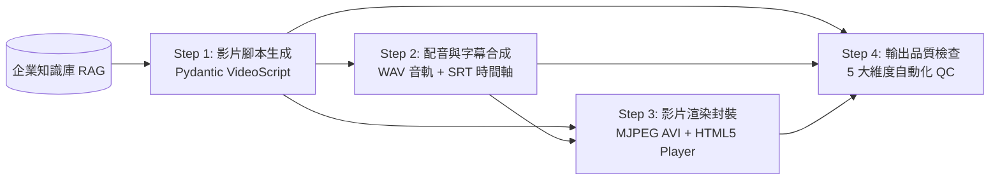

# 🎬 Enterprise AI Video Generator Skill (`enterprise-video-generator`)

本 Skill 基於 `ai-engineering-toolkit` 核心架構（`LLMEngine`、`UniversalDataLoader`、`SimpleHybridRAG`、`ToolAgent`），提供標準化、可稽核的**企業級 AI 影音生成工作流程**。

## 🔄 核心四步工作流程 (4-Stage Workflow)

工作流程強制將「影片腳本」、「配音合成」、「影片生成」與「輸出品質檢查」拆解為獨立可驗證之步驟：



1. **Step 1 — 影片腳本生成 (`step1_generate_script`)**
   - 自動檢索 `./data` 企業知識庫（避免產品規格或安全規範幻覺）。
   - 透過 `LLMEngine.generate_structured(..., response_schema=VideoScript)` 強制輸出包含標題、目標受眾、各幕視覺描述 (`visual_prompt`)、旁白 (`narration`)、精簡字幕 (`subtitle`) 與秒數配置的分鏡腳本。
   - 產出檔案：`outputs/<project_id>/step1_script.json`、`step1_script.md`。

2. **Step 2 — 配音與字幕生成 (`step2_generate_voiceover`)**
   - 讀取 Step 1 分鏡腳本，逐幕合成 24kHz 16-bit PCM `.wav` 語音檔，並自動計算各幕真實語速（字/秒，CPS）。
   - 合併全片音軌並依據真實音訊時長生成時間軸完全對齊的 `.srt` 字幕檔。
   - 產出檔案：`outputs/<project_id>/step2_full_voiceover.wav`、`step2_subtitles.srt`、`step2_voiceover_manifest.json`。

3. **Step 3 — 影片渲染與合成 (`step3_generate_video`)**
   - 依據各幕視覺提示詞、企業識別色系與字幕渲染高解析度分鏡關鍵影格 (`keyframes/scene_XX.png`)。
   - 根據 Step 2 音軌時長與幀率封裝標準 `.avi` 影片檔 (`step3_enterprise_video.avi`)，並同時生成支援音畫同步預覽的互動式 HTML5 播放器 (`step3_interactive_player.html`)。

4. **Step 4 — 輸出品質檢查 (`step4_quality_check`)**
   - 自動執行 5 大維度品質檢核並產出 `step4_quality_report.json`：
     - **`QC-01` 腳本結構完整性與時長配置**：檢查分鏡數量 ($\ge 3$ 幕)、必填欄位非空、總秒數誤差。
     - **`QC-02` 配音音訊完整性與語速合理性**：檢查 WAV 音檔有效、平均播報語速落於 `1.5 ~ 7.5 字/秒` 自然區間。
     - **`QC-03` 影片渲染實體檔案與分鏡關鍵影格**：確認影片容器與各幕分鏡圖完整寫入且非空檔。
     - **`QC-04` 音畫時長同步率與字幕版面**：驗證音軌與影片總時長偏差 $\le 1.5\text{s}$，且單幕字幕不超過 32 字。
     - **`QC-05` 企業合規詞彙與品牌安全防護**：掃描是否含有誇大違規禁用詞（如「保證獲利」、「100%零風險」、「宇宙第一」）。

---

## 🚀 執行指令 (How to Invoke)

### 方式 A：使用 Skill CLI 執行單步或完整管線
執行 [run_video_skill.py](./scripts/run_video_skill.py) 腳本：

```bash
# 1. 一鍵執行完整四步工作流程 (Full Pipeline)
python .claude/skills/enterprise-video-generator/scripts/run_video_skill.py \
  --mode full \
  --topic "PSU-800W 鈦金級伺服器電源產品發表" \
  --audience "資料中心架構師與企業 IT 決策者" \
  --tone "專業、具科技感、權威" \
  --duration 28 \
  --project-id "psu800w_launch"

# 2. 分步獨立執行 (Step-by-Step Execution)
python .claude/skills/enterprise-video-generator/scripts/run_video_skill.py --mode step1 --topic "企業零信任資安防護規範" --project-id "sec_01"
python .claude/skills/enterprise-video-generator/scripts/run_video_skill.py --mode step2 --project-id "sec_01"
python .claude/skills/enterprise-video-generator/scripts/run_video_skill.py --mode step3 --project-id "sec_01"
python .claude/skills/enterprise-video-generator/scripts/run_video_skill.py --mode step4 --project-id "sec_01"
```

### 方式 B：執行完整測試套件 (6 題企業測試案例)
```bash
python tests/run_test_suite.py
```

### 方式 C：啟動視覺化戰情室或 REST API
```bash
streamlit run ui_templates/app_streamlit.py
uvicorn ui_templates.app_fastapi:app --reload --port 8000
```

---

## ✅ 驗證準則 (Validation Steps)
每次執行完畢後，請檢查 `outputs/<project_id>/step4_quality_report.json`：
- 確認 `"overall_passed": true` 且 `"overall_score": 100.0`。
- 若任一 `QC-01` ~ `QC-05` 未通過，請根據 `suggestion` 欄位修正對應步驟後重跑該步驟。
