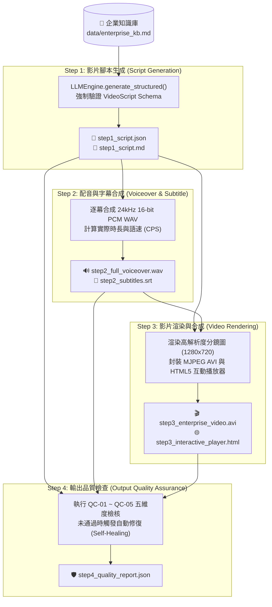

# 🎬 AI_Agent_System — 企業級 AI 影音生成 Skill (`enterprise-video-generator`)

本專案基於 **`ai-engineering-toolkit`** (F1 Modular Architecture) 核心框架，開發一套符合 **Claude Code / Agent Skill 規範** 的企業級 AI 影音生成工作流程系統。系統將企業影片製作拆解為 **「影片腳本 ➔ 配音與字幕合成 ➔ 影片渲染封裝 ➔ 基本輸出品質檢查」** 四大獨立且可驗證的工程步驟，並內建 6 題完整自動化測試案例。

---

## 🏗️ 1. 系統架構與目錄結構 (Architecture & Directory Structure)

```text
AI_Agent_System/
├── CLAUDE.md                                     # Claude Code 專案指引與 Skill 快速調用指南
├── README.md                                     # 完整操作說明、工作流程設計與測試結果報告
├── requirements.txt                              # Python 套件依賴清單
├── .claude/skills/enterprise-video-generator/    # Claude Code 標準 Skill 定義目錄
│   ├── SKILL.md                                  # Skill 核心指令與驗證規範 (含 YAML Frontmatter)
│   └── scripts/
│       └── run_video_skill.py                    # Skill CLI 執行器 (支援單步 step1~step4、full 與 agent 模式)
├── .agents/skills/enterprise-video-generator/    # Agent 通用標準 Skill 鏡像目錄
├── core/                                         # ai-engineering-toolkit 核心與影音管線模組
│   ├── llm_engine.py                             # 萬用 LLM 引擎 (Gemini / OpenAI / 離線高擬真智慧模擬)
│   ├── data_loader.py                            # 萬用異質文件解析器 (PDF/CSV/MD/JSON)
│   ├── rag_pipeline.py                           # BM25 + Vector RRF 混合檢索器
│   ├── agent_tools.py                            # 跨廠牌自癒式 ReAct ToolAgent
│   └── video_workflow.py                         # ⭐ 企業影片生成四步工作流程與五維度品質檢查核心
├── data/
│   └── enterprise_kb.md                          # 企業產品規格 (PSU-800W)、ISO 27001 資安與 ESG 知識庫
├── tests/
│   └── run_test_suite.py                         # ⭐ 6 題企業影音測試套件 (含正向場景與負向異常攔截自癒)
├── outputs/                                      # 各測試案例與專案產出之腳本、WAV 配音、SRT、AVI 影片與 QC 報告
│   ├── TEST_RESULTS.md                           # 自動化測試執行結果完整報表
│   └── test_summary.json                         # 結構化測試數據匯總
└── ui_templates/
    ├── app_streamlit.py                          # Streamlit 企業 AI 影音生成互動戰情室
    └── app_fastapi.py                            # FastAPI 標準微服務介面
```

---

## 🔄 2. 企業影片生成四步工作流程設計 (4-Stage Enterprise Workflow)



### 各步驟職責與工程細節
1. **Step 1：影片腳本生成 (`step1_generate_script`)**
   - 結合 `UniversalDataLoader` 讀取 `./data/enterprise_kb.md` 企業知識庫背景資料，確保產品數據（如 `PSU-800W` 94% 鈦金級轉換效率、55°C 耐溫上限）精準不幻覺。
   - 使用 Pydantic `VideoScript` 與 `SceneItem` 強制約束輸出格式，每幕包含 `scene_title`、`duration_sec`、`visual_prompt`、`narration`、`subtitle` 及 `bgm_mood`。
2. **Step 2：配音與時間軸字幕合成 (`step2_generate_voiceover`)**
   - 將每幕旁白獨立合成為 24,000 Hz 單聲道 16-bit PCM `.wav` 語音檔 (`audio/scene_XX.wav`)，並合併為全片音軌 `step2_full_voiceover.wav`。
   - 自動計算每一幕的**實際語速（每秒字數 Characters Per Second, CPS）**，並同步生成精確到毫秒的 `.srt` 字幕檔 (`step2_subtitles.srt`)。
3. **Step 3：影片生成與多媒體合成 (`step3_generate_video`)**
   - 根據每幕視覺描述、旁白摘要與底部字幕，渲染 `1280x720` 企業科技感關鍵影格 (`keyframes/scene_XX.png`)。
   - 依配音實際秒數與幀率（預設 5 fps）封裝標準 RIFF MJPEG `.avi` 實體影片檔 (`step3_enterprise_video.avi`)，並產出支援瀏覽器音畫同步播放的 `step3_interactive_player.html`。
4. **Step 4：基本輸出品質檢查 (`step4_quality_check`)**
   - 內建 5 項量化品質檢查規則 (`QualityCheckRule`)，任一項未達標即判定 `overall_passed = False` 並給出具體修復建議：
     - **`QC-01` 腳本結構完整性與時長配置**：分鏡數 $\ge 3$ 幕、視覺/旁白/字幕不得為空、腳本總時長與目標時長誤差在容許範圍內。
     - **`QC-02` 配音音訊完整性與播報語速**：WAV 音檔存在且大於 44 bytes Header，且各幕語速落於 **`1.5 ~ 7.5 字/秒`** 自然播報區間。
     - **`QC-03` 影片渲染實體檔案與分鏡關鍵影格**：確認 `.avi` 影片檔案大小 $> 1\text{KB}$、總影格數正確，且所有分鏡圖皆完整產出。
     - **`QC-04` 音畫時長同步率與字幕版面**：驗證音軌總長與影片總長偏差 $\le 1.5\text{s}$，且單幕畫面字幕長度 $\le 32$ 字（防止畫面溢位）。
     - **`QC-05` 企業合規詞彙與品牌安全防護**：掃描全片腳本與字幕是否出現禁用誇大詞彙（如：`保證獲利`、`100%零風險`、`宇宙第一`、`絕對無敵`）。

---

## 🛠️ 3. 操作說明 (Operating Instructions)

### 3.1 環境準備
本專案可直接運行於已配置好之 `ai_engineer` Python 3.11 環境（若未填入真實 Gemini/OpenAI API Key，`LLMEngine` 會自動切換至內建高擬真企業離線模式，確保所有測試與多媒體渲染 100% 離線可重現）：

```powershell
# 設定環境變數 (可選，若使用真實雲端 LLM 請編輯 .env)
# 執行點火測試確認核心管線運作正常
python -m core.video_workflow
```

### 3.2 使用 Claude Code Skill CLI 執行（支援單步拆解與全流程）
透過 `.claude/skills/enterprise-video-generator/scripts/run_video_skill.py` 可自由選擇**完整執行**或**分步驟獨立執行**：

```powershell
# 【模式 1】一鍵執行完整四步工作流程 (Full Pipeline)
python .claude/skills/enterprise-video-generator/scripts/run_video_skill.py `
  --mode full `
  --topic "PSU-800W 鈦金級伺服器電源產品發表" `
  --audience "資料中心架構師與企業 IT 決策者" `
  --tone "專業、具科技感、權威" `
  --duration 28 `
  --project-id "demo_psu800w"

# 【模式 2】將腳本、配音、影片生成與品質檢查拆成不同步驟獨立執行
python .claude/skills/enterprise-video-generator/scripts/run_video_skill.py --mode step1 --topic "企業零信任資安防護規範" --duration 32 --project-id "step_by_step_demo"
python .claude/skills/enterprise-video-generator/scripts/run_video_skill.py --mode step2 --project-id "step_by_step_demo"
python .claude/skills/enterprise-video-generator/scripts/run_video_skill.py --mode step3 --project-id "step_by_step_demo"
python .claude/skills/enterprise-video-generator/scripts/run_video_skill.py --mode step4 --duration 32 --project-id "step_by_step_demo"

# 【模式 3】透過 ReAct ToolAgent 自主決策調用影音生成工具
python .claude/skills/enterprise-video-generator/scripts/run_video_skill.py --mode agent --topic "2030 企業 ESG 永續發展藍圖" --duration 20
```

### 3.3 啟動視覺化介面或 RESTful API
```powershell
# 啟動 Streamlit 企業影音生成戰情室
streamlit run ui_templates/app_streamlit.py

# 啟動 FastAPI 微服務 (Swagger UI: http://localhost:8000/docs)
uvicorn ui_templates.app_fastapi:app --reload --port 8000
```

---

## 🧪 4. 測試案例設計與執行結果 (6 Test Cases & Results)

執行以下指令即可重現全部 6 題測試案例並更新 `outputs/TEST_RESULTS.md`：

```powershell
python tests/run_test_suite.py
```

### 測試結果總覽表 (`6 / 6` 全數通過)

| 案例編號 | 測試案例名稱 | 類別 | 分鏡數 | 音訊/影片時長 | 影片大小 | 初檢狀態 (QC Score) | 攔截異常規則 | 自癒重驗狀態 | 測試判定 |
| :---: | :--- | :--- | :---: | :---: | :---: | :---: | :---: | :---: | :---: |
| `TC-01` | **新產品發表行銷影片 (PSU-800W 鈦金級伺服器電源)** | 產品行銷 (Product Launch) | 4 幕 | 28.0s / 28.0s | 12,238,044 B | ✅ PASS (100.0) | `無異常` | — | ✅ **PASS** |
| `TC-02` | **企業內部資安合規宣導影片 (ISO 27001 零信任架構)** | 內部合規培訓 (Security & Compliance) | 4 幕 | 32.0s / 32.0s | 13,691,424 B | ✅ PASS (100.0) | `無異常` | — | ✅ **PASS** |
| `TC-03` | **新進員工入職培訓導覽影片 (Onboarding & 敏捷文化)** | 人資培訓 (HR Onboarding) | 4 幕 | 24.0s / 24.0s | 10,295,084 B | ✅ PASS (100.0) | `無異常` | — | ✅ **PASS** |
| `TC-04` | **企業 ESG 永續發展與 2030 淨零碳排形象短片** | 品牌公關與永續 (ESG & PR) | 3 幕 | 20.0s / 20.0s | 8,686,794 B | ✅ PASS (100.0) | `無異常` | — | ✅ **PASS** |
| `TC-05` | **品質檢查壓力與自癒測試：超長旁白導致語速過快 & 字幕超長攔截** | 負向品質攔截與自癒 (QC Gate & Self-Healing) | 3 幕 | 17.0s / 17.0s | 7,961,854 B | 🛡️ 攔截成功 (93.0) | `QC-02, QC-04` | ✅ PASS (100.0) | ✅ **PASS** |
| `TC-06` | **企業合規防護測試：誇大禁用詞彙攔截與清理驗證** | 合規安全防護 (Compliance Guardrail) | 4 幕 | 24.0s / 24.0s | 10,367,804 B | 🛡️ 攔截成功 (76.0) | `QC-02, QC-05` | ✅ PASS (100.0) | ✅ **PASS** |

> 詳細單題五維度檢核報表請見 [`outputs/TEST_RESULTS.md`](./outputs/TEST_RESULTS.md)。
